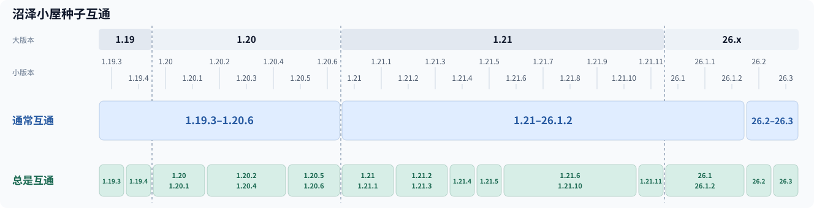
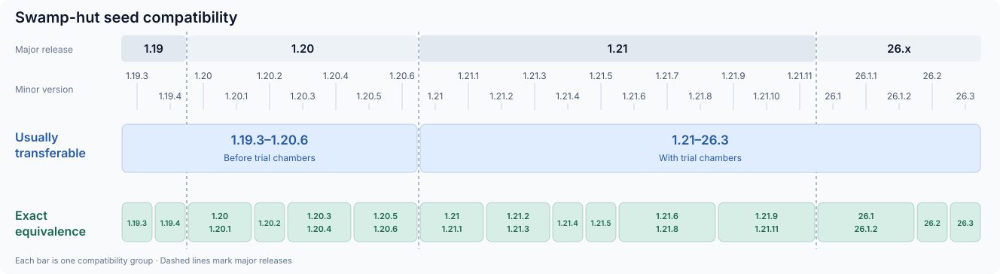

# 版本与种子互通

 

支持 **1.19.3–26.3 的全部正式版**，原版验证按以下 14 个区间运行。同一区间内，小屋相关生成行为相同；程序选用其中一个版本实际生成，称为代表版本。

图中区间适用于正常世界。大型群系和单群系的配置见[世界类型](../README.md#世界类型)。

## 版本区间与改动

| 验证区间 | 代表版本 | 起点版本的具体改动 |
|---|---|---|
| 1.19.3 | 1.19.3 | — |
| 1.19.4 | 1.19.4 | 紫水晶洞生成修改 |
| 1.20–1.20.1 | 1.20.1 | 新加入古迹废墟 |
| 1.20.2–1.20.4 | 1.20.2 | 新增中型钻石矿地物 |
| 1.20.5–1.20.6 | 1.20.6 | 沉船生成修改 |
| 1.21–1.21.1 | 1.21 | 新加入试炼密室 |
| 1.21.2–1.21.3 | 1.21.3 | 含水层流体更新修改；试炼密室生成修改 |
| 1.21.4 | 1.21.4 | 新加入苍白之园；地物排序变化 |
| 1.21.5 | 1.21.5 | 新加入萤火虫灌木 |
| 1.21.6–1.21.10 | 1.21.8 | 落叶生成修改 |
| 1.21.11 | 1.21.11 | 水下岩浆块生成修改 |
| 26.1–26.1.2 | 26.1.2 | 蘑菇等植物生成修改 |
| 26.2 | 26.2 | 新加入硫磺洞穴；洞穴噪声计算修改 |
| 26.3 | 26.3 | 新加入斑驳森林；噪声计算精度修改 |

## 运行配置

1.19.3–1.21.11 使用 Java 21，26.x 使用 Java 25。[profiles.json](../config/versions/profiles.json) 保存每个版本使用的筛选参数与验证代表版本；[compatibility.json](../config/versions/compatibility.json) 保存图中的版本分组。服务准备和加载顺序见[原版验证](VERIFICATION.md)。

---

# Versions and seed compatibility

 

Supports **every release from 1.19.3 through 26.3**, with vanilla verification organized into 14 intervals. Versions in an interval share the same hut-related generation behavior; the program runs one chosen version, called its representative.

The diagram applies to normal worlds. For large-biome and single-biome settings, see [world types](../README.md#world-types).

## Version intervals and changes

| Verification interval | Representative | Changes at the start of the interval |
|---|---|---|
| 1.19.3 | 1.19.3 | — |
| 1.19.4 | 1.19.4 | Amethyst geode generation changed |
| 1.20–1.20.1 | 1.20.1 | Trail ruins added |
| 1.20.2–1.20.4 | 1.20.2 | Medium diamond ore feature added |
| 1.20.5–1.20.6 | 1.20.6 | Shipwreck generation changed |
| 1.21–1.21.1 | 1.21 | Trial chambers added |
| 1.21.2–1.21.3 | 1.21.3 | Aquifer fluid updates and trial chamber generation changed |
| 1.21.4 | 1.21.4 | Pale garden added; feature ordering changed |
| 1.21.5 | 1.21.5 | Firefly bush added |
| 1.21.6–1.21.10 | 1.21.8 | Leaf litter generation changed |
| 1.21.11 | 1.21.11 | Underwater magma generation changed |
| 26.1–26.1.2 | 26.1.2 | Mushroom and other plant generation changed |
| 26.2 | 26.2 | Sulfur caves added; cave noise calculations changed |
| 26.3 | 26.3 | Dappled forest added; noise calculation precision changed |

## Runtime configuration

Use Java 21 for 1.19.3–1.21.11 and Java 25 for 26.x. [profiles.json](../config/versions/profiles.json) records the screening parameters and verification representative used for each version; [compatibility.json](../config/versions/compatibility.json) records the version groups shown in the diagram. See [verification](VERIFICATION.md#english) for service setup and loading orders.
